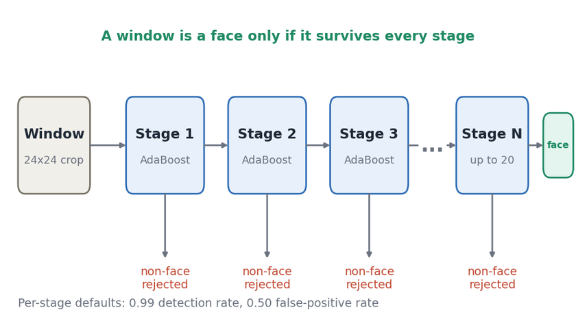
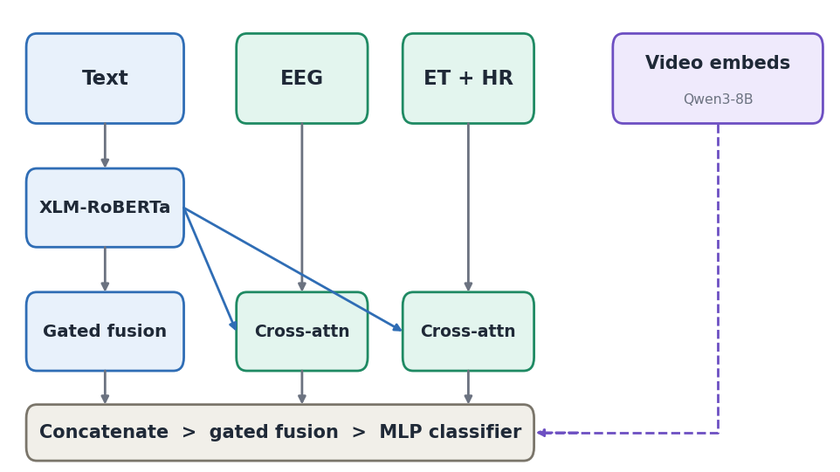
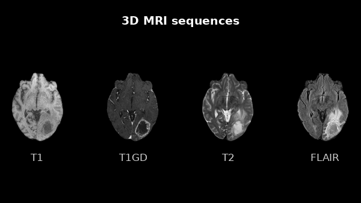
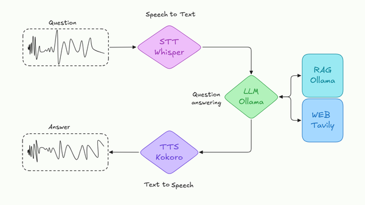
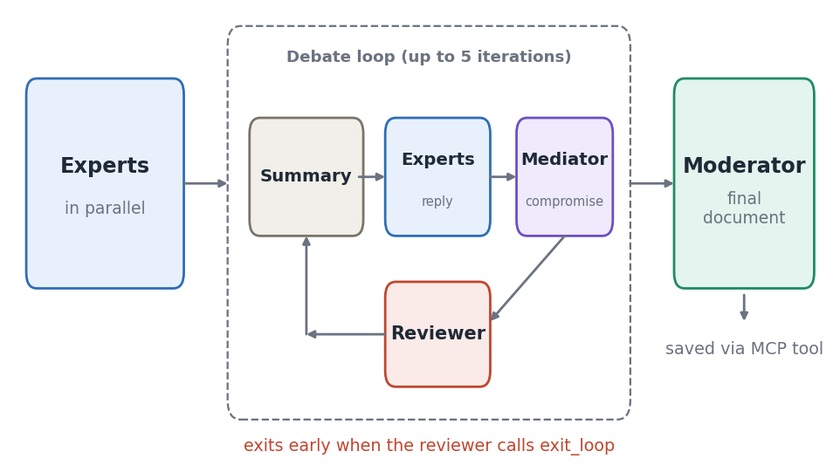
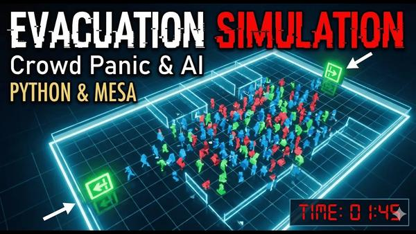

<h1>Andrés Pacheco Millán</h1>
<b>AI / Machine Learning Engineer · Computer Vision</b> 
2 years in ML: vision, NLP, tabular · MSc in AI (UPV) · Spain 

## Selected projects

<table>
<tr>
<td width="50%" valign="top">
 
<b><a href="https://github.com/standby73/viola-jones-face-detection">viola-jones-face-detection</a></b> 
Haar features, AdaBoost cascade, hard-negative mining and a real-time Numba webcam detector. 
<b>Built from scratch, no pretrained detector</b> 
   
</td>
<td width="50%" valign="top">
 
<b><a href="https://github.com/standby73/multimodal-sexism-detection-tiktok">multimodal-sexism-detection-tiktok</a></b> 
Multimodal classifier (text, biosignals, video) for the EXIST 2026 challenge. 
<b>80.6 macro F1 on the binary task (project presentation)</b> 
 
</td>
</tr>
<tr>
<td width="50%" valign="top">
 
<b><a href="https://github.com/standby73/glioblastoma-survival-missing-modalities">glioblastoma-survival-missing-modalities</a></b> 
Survival classification from 3D MRI, radiomics and clinical data, built for missing inputs. 
<b>Best test F1 0.685 (single runs, 61-patient test set)</b> 
 
</td>
<td width="50%" valign="top">
 
<b><a href="https://github.com/standby73/voice-assistant-whisper-rag-tts">voice-assistant-whisper-rag-tts</a></b> 
Speech-to-speech RAG assistant; local and cloud pipelines compared. 
<b>60 tests (30 local, 30 cloud); best mix about 7.5 s per answer</b> 
   
</td>
</tr>
<tr>
<td width="50%" valign="top">
 
<b><a href="https://github.com/standby73/multi-agent-expert-debate">multi-agent-expert-debate</a></b> 
LLM experts debate until a reviewer confirms consensus; a moderator writes the decision. 
<b>Up to 5 debate rounds, 12 ready-made debates</b> 
  
</td>
<td width="50%" valign="top">
 
<b><a href="https://github.com/standby73/crowd-evacuation-simulation">crowd-evacuation-simulation</a></b> 
Agent-based evacuation: density, behaviours, exits and pathfinding. 
<b>1000 runs per configuration across 7 dimensions</b> 
 
</td>
</tr>
</table>

Several of these were built together with [Miquel Gómez Corral](https://github.com/MiquelGomezCorral); each repository says which. Diagrams for the Viola-Jones, sexism-detection and debate cards are original summaries of each repository's README.

## Toolbox

<table width="100%">
<tr><td width="140"><b>Languages</b></td><td>  </td></tr>
<tr><td><b>ML / DL</b></td><td>       </td></tr>
<tr><td><b>LLM and RAG</b></td><td>   </td></tr>
<tr><td><b>Deployment</b></td><td>    </td></tr>
<tr><td><b>Optimisation</b></td><td>   </td></tr>
</table>

AWS, Azure and CI/CD: working knowledge.
